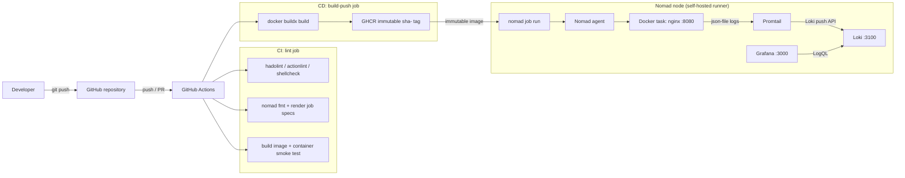

# Architecture and design decisions

## Component diagram

## Pipeline contract between stages

The pipeline is intentionally strict about what each stage produces and
consumes.

| Stage | Input | Output consumed by the next stage |
| --- | --- | --- |
| Source | `app/index.html`, `app/hello.conf`, `app/Dockerfile`, `nomad/*.hcl` | Build context and deployment spec |
| Build | Build context + `BUILD_ID`, `GIT_SHA`, `BUILD_DATE`, `BUILD_REPOSITORY` | Image whose `/build-info.json` identifies the build |
| CI lint | Image | Container that passes the health and provenance assertions |
| CI push | Passing image | Immutable GHCR reference `ghcr.io/<owner>/<repo>:sha-<short>` |
| Deploy | Immutable image reference | Running Nomad allocation on `:8080` |
| Observability | Docker `json-file` logs | Queryable Loki stream and Grafana dashboard |

If any link is broken, the next stage fails or has no data. For example, the
deploy job asserts that the ID reported by `/build-info.json` equals the
`BUILD_ID` computed by the build job, which proves that Nomad is running the
image CI just built rather than a stale `latest`.

## Why Nomad host networking with a static port?

The assessment target is a single Nomad node. Nomad's default group network
mode is `host`, and host mode needs no CNI plugins. That makes the stack
reproducible on a clean machine:

- the NGINX container binds `:8080` on the host;
- Nomad's native service registration and HTTP check target `:8080`;
- Loki, Promtail and Grafana use host networking and reach each other on
  loopback.

The trade-off is that only one allocation can bind `:8080` per node. The job
therefore defaults to `count = 1`. Scaling out requires dynamic ports and either
bridge networking with CNI plugins or one allocation per node behind a load
balancer. This is documented rather than hidden.

## Why Nomad-native service discovery?

Consul is not part of the assessment environment. Nomad 1.7+ supports a native
service provider with TCP and HTTP checks. The job registers the service and
checks `/healthz` without adding a Consul dependency. Native service discovery
also makes the coupling between the Nomad job and the health endpoint explicit.

## Build provenance

Three values are baked into the image at build time:

- `BUILD_ID`: local Git short SHA, or `<GitHub run number>-<short SHA>` in CI.
- `GIT_SHA`: full commit SHA.
- `BUILD_DATE`: UTC build timestamp.

The Dockerfile rewrites the placeholders in `index.html` and writes
`build-info.json`. A CI smoke test and the deploy job both read the JSON back
from the running container. This makes the build identifier verifiable rather
than merely displayed.

Build-time injection was chosen over runtime environment variables because the
requirement is that the identifier belongs to the image. An environment variable
can drift from the image content; a baked value cannot.

## Logging data flow

1. Nomad's Docker driver uses the `json-file` logging driver (with rotation).
2. Promtail's Docker service discovery enumerates containers through the Docker
   socket.
3. A relabel rule keeps containers whose Nomad job label is `nginx`,
   preventing the observability containers from feeding back into Loki.
4. The JSON pipeline stage extracts the Docker `log`, `stream` and `time`
   fields, uses the Docker timestamp and replaces the line with the message.
5. Promtail pushes to `http://127.0.0.1:3100/loki/api/v1/push`.
6. Grafana uses the provisioned `loki` datasource and the `{job="nginx"}`
   stream.

Loki stores chunks and index in the allocation's `local` directory. On a single
node with `ephemeral_disk { migrate = true }`, the data survives allocation
restarts and moves with the allocation. For a production deployment, replace
this with a host volume, NFS or object storage and enable the retention policy
you need (the local config keeps 168 hours).

## Failure handling

| Failure | Behaviour |
| --- | --- |
| Build provenance missing | Docker `RUN grep` fails the image build. |
| Image fails health check | CI container smoke test fails; image is not pushed. |
| Nomad deployment unhealthy | `healthy_deadline` / `progress_deadline` fail the deployment; `auto_revert = true` restores the previous version. |
| Task crashes | `restart` retries three times within five minutes; Nomad reschedules the allocation. |
| Promtail cannot reach Loki | Logs remain in Docker's json-file buffer; Promtail retries pushes. |
| Grafana cannot reach Loki | Dashboard shows a datasource error; application traffic is unaffected. |

## Security boundaries and limitations

- The local agent is bound to `127.0.0.1` with no ACLs. Do not expose it.
- Promtail mounts the Docker socket. Treat the Nomad client and the Promtail
  container as privileged infrastructure.
- The local Grafana has anonymous viewer access and a default admin password.
  These are assessment conveniences, not production settings.
- The CI deploy job uses repository secrets for `NOMAD_ADDR` and optionally
  `NOMAD_TOKEN`; no credentials are baked into the repository or the image.
- The base image is pinned to `nginx:1.29.8-alpine`, and observability images
  use explicit version tags. Dependabot or a scheduled rebuild is recommended
  for ongoing patch management.
